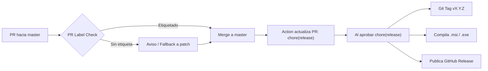

# Bisync POS — Terminal P2P Local-First

Sistema de Punto de Venta (POS) y facturación bimoneda (USD / VES) diseñado bajo una arquitectura **Local-First P2P pura** ($0 Cloud / Cero Servidores Backend centralizados).

Toda la base de datos, la lógica de negocio, el inventario por Kardex conmutativo, la facturación inmutable y la sincronización entre cajas por red local (Wi-Fi) se ejecutan directamente en los dispositivos de la tienda.

---

## 📱 Aplicaciones y Componentes del Proyecto

El repositorio es un monorepo que alberga tres módulos principales:

```
simple-crm/
├── frontend/             # Aplicación principal en React Native (Expo SDK 52)
│   └── src-tauri/        # Wrapper de escritorio en Rust (Tauri v2) para Windows
├── license-issuer/       # CLI offline en Go para emisión criptográfica Ed25519
├── docs/                 # Esquemas SQL, auditorías y guías de diseño
└── .github/              # Automatización de CI/CD, control de versiones y releases
```

### 1. `frontend/` (React Native + Expo SDK 52 + Tauri v2)
* **Plataformas:** 
  * **Escritorio:** Windows (vía Tauri v2 con empaquetador NSIS y MSI).
  * **Móvil / Tablet:** Android (APK / Tablets en orientación Landscape 1280×800 px).
  * **Web:** Modo contingencia y previsualización.
* **Persistencia:** SQLite local nativo (`op-sqlite` con modo WAL y foreign keys en Android/Desktop; SQLite relacional en navegador/test).
* **Red Local:** Descubrimiento de terminales en red Wi-Fi por **mDNS** (`_cajapos._tcp`) y transporte HTTP directo entre cajas de la misma cuenta (`tenant_id`).

### 2. `frontend/src-tauri/` (Capa de Escritorio en Rust)
* Emite el binario ejecutable y los instaladores empaquetados para Windows (`.msi` y `-setup.exe`).
* Extrae el identificador inmutable de hardware en Windows (`HWID = SHA256(Motherboard_UUID:CPU_Serial)`).
* Expone comandos nativos del sistema operativo, como el diálogo nativo de Windows `SaveFileDialog` para guardar y descargar archivos JSON.
* Integra el script personalizado [`hooks.nsh`](frontend/src-tauri/hooks.nsh) para advertir al usuario y conservar la base de datos por defecto al actualizar o desinstalar.

### 3. `license-issuer/` (CLI Offline en Go)
* Módulo independiente en Go que genera llaves y firma licencias comerciales fuera de línea con **Ed25519**.
* La app cliente en `frontend` únicamente **verifica** la firma con su llave pública embebida; la llave privada jamás toca la app ni se sube al repositorio.
* Documentación detallada en [`license-issuer/README.md`](license-issuer/README.md).

---

## 🏛️ Reglas Estrictas del Sistema (Cero Desviaciones)

Todo desarrollo en este repositorio debe respetar obligatoriamente las directrices de [`AGENTS.md`](AGENTS.md):

1. **Local-First P2P Puro:** Prohibido agregar dependencias que requieran bases de datos en la nube o servidores web centrales de datos. Los dispositivos en la misma tienda se sincronizan directamente vía Wi-Fi.
2. **Identificadores UUIDv7:** Todas las transacciones, productos, turnos, movimientos de stock y tasas cambiarias deben usar obligatoriamente **UUIDv7** para garantizar orden cronológico y evitar colisiones entre cajas.
3. **Matemática Financiera de Precisión Fija:** Prohibido el uso de tipos flotantes nativos (`number` / `REAL`) en precios, tasas o inventario. Se utiliza precisión fija interna de 4 decimales (`decimal.js`) y redondeo estándar (`ROUND_HALF_UP`) a 2 decimales para la liquidación final en caja.
4. **Kardex Conmutativo por Deltas:** Ninguna caja puede sobreescribir el stock de otra. El inventario se calcula dinámicamente sumando los registros inmutables de `stock_movements` (`+10.0000`, `-1.0000`).
5. **Inmutabilidad en Facturación:** Cada factura congela de forma permanente la tasa de cambio BCV aplicada (`exchange_rate`), los montos en USD y su equivalente legal en VES. Jamás se recalculan retrospectivamente.
6. **Diseño Visual y Reglas Táctiles:** Cumplimiento estricto de [`docs/skills/bisync-pos-design-guide.md`](docs/skills/bisync-pos-design-guide.md):
   * Touch Targets mínimos de **48×48 px** (64 px para cobro, cierre Z y numpad).
   * Formateo numérico tabular (`tabular-nums`) en importes monetarios.
   * Modos Oscuro (`#0A0D12`) y Claro (`#F4F6F8`) nativos sin dependencia de eventos `hover`.

---

## 🏷️ Flujo de Versionado y CI/CD (GitHub Actions)

El proyecto utiliza un sistema de gestión de versiones completamente automatizado con **Release Candidate PRs** basado en etiquetas:



### Etiquetas de Versión (Labels)
Al abrir un Pull Request hacia `master`, se debe seleccionar una de estas etiquetas en el panel lateral de GitHub:

* **`release:patch`**: Correcciones de errores o ajustes menores (`0.1.0` ➔ `0.1.1`).
* **`release:minor`**: Nuevas funcionalidades retrocompatibles (`0.1.0` ➔ `0.2.0`).
* **`release:major`**: Cambios estructurales grandes o incompatibles (`0.1.0` ➔ `1.0.0`).
* **`skip-release`**: Tareas internas, pruebas o documentación que no alteran la versión.

> **Regla de Seguridad:** Si un PR se fusiona sin etiqueta, el sistema ejecuta un **fallback automático a `release:patch`**, garantizando que ningún cambio se pierda del historial ni del changelog.

---

## 💻 Comandos de Desarrollo y Compilación

Todos los comandos de desarrollo se ejecutan desde el directorio `frontend/`:

```powershell
cd frontend
```

### Entorno de Desarrollo (con HMR y recarga en caliente)
```powershell
npm run desktop:dev      # Abre la app de escritorio Windows con Tauri
npm run web              # Inicia la versión Web en http://localhost:8081
npm run android          # Inicia la app en emulador o dispositivo Android
```

### Compilación para Producción (Instaladores)
```powershell
npm run desktop:build    # Compila el ejecutable optimizado y genera el instalador NSIS (.exe) y MSI
npm run web:build        # Exporta los assets web estáticos a dist/
```

### Pruebas y Calidad de Código
```powershell
npm test                 # Ejecuta la suite de 247 tests automatizados con Vitest
npm run typecheck        # Chequeo estricto de tipos con TypeScript (tsc --noEmit)
```

### Sincronización Manual de Versión
```powershell
npm run version:set -- 0.2.0    # Sincroniza package.json, app.json, tauri.conf.json y Cargo.toml
npm version patch               # Incremento patch estándar
npm version minor               # Incremento minor estándar
npm version major               # Incremento major estándar
```

---

## 📚 Enlaces a Documentación del Proyecto

* **[Constitución del Sistema y Reglas Técnicas (`AGENTS.md`)](AGENTS.md)**: Reglas de oro para agentes y desarrolladores, arquitectura local-first y hardware binding.
* **[Tablero de Control y Bitácora de Micro-PRs (`HARNESS_CONTROL.md`)](HARNESS_CONTROL.md)**: Historial secuencial de micro-PRs completados (PR-01 a PR-24) y backlog de desarrollo.
* **[Esquema de Base de Datos SQLite DDL (`docs/database_schema.sql`)](docs/database_schema.sql)**: Fuente única de la verdad del esquema relacional DDL.
* **[Guía de Diseño POS y Tokens Visuales (`docs/skills/bisync-pos-design-guide.md`)](docs/skills/bisync-pos-design-guide.md)**: Tokens de color, componentes táctiles y look & feel.
* **[Auditoría de Inmutabilidad Histórica (`docs/auditoria-inmutabilidad-historica.md`)](docs/auditoria-inmutabilidad-historica.md)**: Pruebas y garantías de inmutabilidad en tasas y facturas.
* **[CLI Emisor de Licencias Offline (`license-issuer/README.md`)](license-issuer/README.md)**: Guía de uso para emisión de tokens criptográficos Ed25519.
